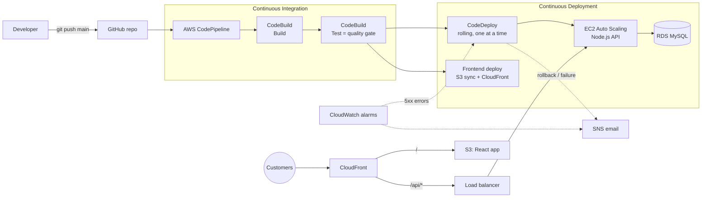

# QuickBite: CI/CD Pipeline for a Cloud-Based Web App

QuickBite is an online food ordering web app (React frontend, Node.js API, MySQL database). It deploys to AWS through a fully automated CI/CD pipeline: **push to GitHub → build → test → deploy → monitor**, with no manual steps. Bad code is stopped by the tests, and a bad release is rolled back automatically.

This repository is the working implementation of the *Cloud Computing Review 1* use case.



## What's in the repo

| Path | What it is | Slide |
| --- | --- | --- |
| `backend/` | Node.js + Express API: menu, coupons, orders, **live order tracking** | 10, 13 |
| `backend/tests/` | 39 Jest tests: unit (pricing, tracking) and integration (HTTP API) | 6 |
| `frontend/` | React (Vite) app: menu, cart, coupons, checkout, live tracking page | 10 |
| `buildspec/build.yml` | **Build** stage: installs packages, builds React, stamps the commit id | 11 |
| `buildspec/test.yml` | **Test** stage, the quality gate: any failing test stops the pipeline | 6, 11, 14 |
| `backend/appspec.yml` + `backend/scripts/` | **CodeDeploy** steps: stop, install, start, health check | 7, 12 |
| `infra/quickbite-cicd.yml` | **CloudFormation**: creates the whole AWS setup in one go | 9, 12 |
| `tools/traffic.sh` | Sends steady traffic, used in the rollback demo | 14 |
| `cloudbuild.yaml` + `Dockerfile` | **Google Cloud pipeline** (deployed): build, test, deploy to Cloud Run, smoke test, release | 11, 14 |
| `infra/gcp/setup.sh` | Creates the Artifact Registry repo, deployer account and Cloud Build trigger | 9 |
| `infra/azure/setup.sh` | Earlier Azure attempt (not used) | — |

### The app

- **Menu** with categories and a veg-only filter.
- **Cart** priced by the server: item total, coupon, delivery fee (free above ₹499) and 5% GST.
- **Coupons**: `WELCOME50` (50% off up to ₹100, min ₹199), `FLAT75` (₹75 off, min ₹299), `FREEDEL` (free delivery).
- **Live order tracking**: after checkout, the order moves Placed → Confirmed → Preparing → Out for delivery → Delivered. The page polls the API every 5 s. The kitchen and rider are simulated: by default each stage takes 30 s (`TRACKING_STEP_SECONDS`).
- **`/api/health`** checks the database. The load balancer, CodeDeploy's ValidateService hook and CloudWatch all use it.
- **`/api/version`** returns the Git commit that CodeBuild built. It appears in the site footer, so you can see each deployment go live.

### API

| Method | Path | Purpose |
| --- | --- | --- |
| GET | `/api/health` | Health check (503 if the database is unreachable) |
| GET | `/api/version` | Deployed commit and build time |
| GET | `/api/menu` | Menu items |
| GET | `/api/coupons` | Available coupons |
| POST | `/api/cart/quote` | `{items:[{id,quantity}], coupon}` → priced bill |
| POST | `/api/orders` | `{items, coupon, customer:{name,phone,address}}` → order + tracking |
| GET | `/api/orders/:id` | Order with live tracking status |

---

## Run it on your laptop

You need Node.js 20 or later.

```bash
# 1. API (uses an in-memory store when DB_HOST isn't set)
cd backend
npm install
npm test                 # 39 tests
TRACKING_STEP_SECONDS=5 npm run dev     # http://localhost:3000/api/health

# 2. Frontend (in a second terminal)
cd frontend
npm install
npm test                 # 7 tests
npm run dev              # http://localhost:5173  (proxies /api to :3000)
```

On Windows PowerShell, set the variable first: `$env:TRACKING_STEP_SECONDS=5; npm run dev`.

**With MySQL (optional):** run `docker compose up -d`, then start the API with `DB_HOST=127.0.0.1 DB_PASSWORD=quickbite npm run dev`. Tables and the starter menu are created automatically on first start.

---

## Deploy on Google Cloud (Cloud Build + Cloud Run) — the live version

This is the version that is actually deployed. It stays within Google Cloud's free tier for a student demo.

**Live site:** https://quickbite-e5l5uzhnea-uc.a.run.app (the footer shows the deployed commit)

| Slide stage | AWS version | Google Cloud version |
| --- | --- | --- |
| Source | GitHub + CodePipeline | GitHub + **Cloud Build trigger** on push to `main` |
| Build | CodeBuild | Cloud Build step **Build**: Docker image with the React build + API (`Dockerfile`) |
| Test (quality gate) | CodeBuild | Cloud Build step **Test**: the same backend + frontend tests; any failure stops the build |
| Artifact store | S3 | **Artifact Registry** (Docker repo `quickbite`) |
| Deploy | CodeDeploy + EC2 Auto Scaling | **Cloud Run** new revision with *no traffic*, tagged `candidate` |
| Monitor + rollback | CloudWatch alarm → CodeDeploy rollback | Step **Monitor** runs `tools/smoke-test.sh` on the candidate URL. If it fails, traffic never moves, so customers stay on the last good revision |
| Release | — | Step **Release** sends 100% of traffic to the new revision |
| Alerts | SNS email | Cloud Build build history + the GitHub commit check turns red |

The whole pipeline is in `cloudbuild.yaml`. One Cloud Run service hosts both the site and the API, using the in-memory store (no paid database). `--max-instances 1` keeps all orders on one instance; orders are lost when Cloud Run scales to zero.

**Setup (one time), in [Cloud Shell](https://shell.cloud.google.com):**
```bash
git clone https://github.com/<you>/quickbite-cicd.git && cd quickbite-cicd
gcloud config set project <your-project-id>
bash infra/gcp/setup.sh <you>            # first run prints a GitHub link: open it and install the Cloud Build app
bash infra/gcp/setup.sh <you>            # second run links the repo and creates the trigger
gcloud builds triggers run quickbite-main --region us-central1 --branch main
```
Watch it in **Cloud Build → History**. The site URL is printed by the Release step (`https://quickbite-<number>.us-central1.run.app`).

**Demos on Google Cloud:** Demo 1 and 2 work as written below (push → watch Cloud Build). For Demo 3, the production-only bug makes the **Monitor** step fail on the candidate revision; open the site and you'll see it still runs the previous commit. **Manual rollback** to any older revision: Cloud Run → quickbite → Revisions → *Manage traffic*, or `gcloud run services update-traffic quickbite --region us-central1 --to-revisions <revision>=100`.

**Clean up:** `gcloud run services delete quickbite --region us-central1` and `gcloud artifacts repositories delete quickbite --location us-central1`, or delete the whole project.

---

## Deploy for free on Azure (GitHub Actions + App Service F1)

This is the free-tier version of the same pipeline. Everything is the same up to deployment:

| Slide stage | AWS version | Azure version (free) |
| --- | --- | --- |
| Source | GitHub + CodePipeline | GitHub + GitHub Actions (`.github/workflows/azure-cicd.yml`) |
| Build | CodeBuild | Actions job **Build**: builds React, bundles it with the API (`tools/package-azure.sh`) |
| Test (quality gate) | CodeBuild | Actions job **Test**: the same 39 + 7 tests; any failure stops the run |
| Deploy | CodeDeploy (rolling) + S3/CloudFront | Actions job **Deploy**: zip deploy to Azure App Service (Linux, Free F1) |
| Monitor + rollback | CloudWatch alarm → CodeDeploy rollback | `tools/smoke-test.sh` checks the live site; if it fails, the **Rollback** job redeploys the last good commit |
| Alerts | SNS email | GitHub emails you when a run fails |

On Azure, one App Service hosts both the website and the API (Express serves the React build), and the app uses its in-memory store. That avoids paying for a database.

**Setup (one time):**
1. Push this project to a GitHub repository (public repos get unlimited free Actions minutes).
2. Open [Azure Cloud Shell](https://shell.azure.com) (Bash), upload or clone the repo, run `gh auth login`, then from the repo folder run:
   ```bash
   bash infra/azure/setup.sh
   ```
   This creates the resource group, the free F1 plan and the web app. It also saves `AZURE_WEBAPP_NAME` (variable) and `AZURE_WEBAPP_PUBLISH_PROFILE` (secret) to the GitHub repo.
3. In GitHub, go to **Actions → QuickBite CI/CD → Run workflow** (or push a commit). The site goes live at `https://<app-name>.azurewebsites.net`.

The demos below work the same way on Azure. Demo 3's production-only bug makes the smoke test fail, which triggers the Rollback job.

**Free-tier limits:** F1 apps sleep when idle, so the first request takes 20–60 seconds. They also get 60 CPU-minutes a day, and orders are lost whenever the app restarts. To remove everything: `az group delete -n quickbite-rg`.

---

## Deploy the pipeline to AWS

### Before you start

- An AWS account and permission to create IAM roles (an admin user or a lab account with full access).
- Your own copy of this repository on GitHub, with the code pushed to `main`.
- **Cost:** this runs real resources (2 × t3.micro, a load balancer, and RDS db.t3.micro if enabled). Some are covered by the free tier, but the load balancer is not. Expect a few US dollars per day. **Delete the stack when you're done** (see Clean up below).

### Steps

1. **Push this project to GitHub**
   ```bash
   git init && git add . && git commit -m "QuickBite with CI/CD"
   git branch -M main
   git remote add origin https://github.com/<you>/quickbite-cicd.git
   git push -u origin main
   ```

2. **Create the CloudFormation stack.** In the AWS Console, go to **CloudFormation → Create stack → With new resources**, upload `infra/quickbite-cicd.yml`, and fill in:
   - **Stack name:** `quickbite`
   - **GitHubOwner / GitHubRepo:** your GitHub username and repo name
   - **VpcId:** your default VPC
   - **SubnetIds:** pick **two or more** default-VPC subnets in different Availability Zones
   - **NotificationEmail:** your email address
   - **CreateDatabase:** `true` for RDS MySQL (adds about 10 minutes to stack creation), or `false` to save cost

   Tick *"I acknowledge that AWS CloudFormation might create IAM resources"* and create the stack. It takes about 10–15 minutes.

   Or use the AWS CLI:
   ```bash
   aws cloudformation deploy --stack-name quickbite \
     --template-file infra/quickbite-cicd.yml --capabilities CAPABILITY_IAM \
     --parameter-overrides GitHubOwner=<you> GitHubRepo=quickbite-cicd \
       VpcId=vpc-xxxx SubnetIds=subnet-aaaa,subnet-bbbb NotificationEmail=<you@example.com>
   ```

3. **Confirm the SNS email.** AWS sends a "Subscription Confirmation" email. Click the link in it, or you won't receive alerts.

4. **Connect GitHub (one time only).** Go to **Developer Tools → Settings → Connections**, open `quickbite-github` (status *Pending*), choose **Update pending connection**, and authorise the AWS Connector for GitHub on your repository. The status changes to *Available*.

5. **Run the pipeline.** In **CodePipeline → quickbite-pipeline**, click **Release change**. (The first automatic run failed because the connection wasn't approved yet; that's expected.) Watch the stages go Source → Build → Test → Deploy.

6. **Open the site.** The **WebsiteUrl** is under the stack's **Outputs** tab (`https://dxxxx.cloudfront.net`). The footer shows the commit that was deployed.

From now on, every `git push` to `main` deploys automatically.

---

## Demo scenarios (matching the Review 1 slides)

### Demo 1: a feature goes live with no manual steps (slide 13)
Make a visible change, for example the headline in `frontend/src/App.jsx` or a new dish in `backend/src/store/seed.js`. (With RDS, the menu is seeded only once, so add the dish with SQL or use the in-memory mode.) Then:
```bash
git commit -am "Update headline" && git push
```
Watch CodePipeline. In CodeDeploy you can see the servers being updated **one at a time** while the site stays up. When the pipeline finishes, the footer shows the new commit.

### Demo 2: a test fails, so nothing is deployed (slide 14, case 1)
Break the coupon maths in `backend/src/services/pricing.js`, for example change `subtotal * 0.5` to `subtotal * 0.4`, then push. The **Test** stage fails on the `apply coupon` tests and the pipeline stops, so the live site keeps running the previous version. You get a "pipeline failed" email. You can see the failing test under **CodeBuild → Report groups**. Revert and push to fix.

### Demo 3: errors after deployment trigger automatic rollback (slide 14, case 2)
This simulates a bug that the tests don't catch. In `backend/src/app.js`, make the menu route fail only in production:
```js
app.get('/api/menu', asyncRoute(async (req, res) => {
  if (process.env.NODE_ENV === 'production') throw new Error('demo bug');
  res.json(await store.listMenu());
}));
```
Start `./tools/traffic.sh https://<your-cloudfront-domain>`, then push. The tests pass (they don't run in production mode), and CodeDeploy starts updating servers. Once the updated server receives traffic, it returns 500s. The **ApiErrorAlarm** fires, CodeDeploy **stops and rolls back** to the last good version, and SNS emails the team. Revert the change afterwards.

> CodeDeploy watches the alarm *while a deployment is running*. With two servers updated one at a time, that window is a few minutes, which is why steady traffic is needed for this demo.

---

## How each stage works

| Stage | Service | What happens | If it fails |
| --- | --- | --- | --- |
| Source | GitHub + CodeStar connection | A push to `main` starts the pipeline | — |
| Build | CodeBuild (`buildspec/build.yml`) | `npm ci`, build React, write `version.json`, output BackendBundle + FrontendBundle | Pipeline stops |
| Test | CodeBuild (`buildspec/test.yml`) | Backend Jest tests with coverage (minimum 70% of lines), frontend Vitest tests, JUnit + coverage reports | Pipeline stops. Nothing deployed |
| Deploy API | CodeDeploy, `OneAtATime` | Each server is removed from the load balancer, then the deploy hooks run: stop → clean → `npm ci --omit=dev` → write config → start → health check. Then the server is added back | Automatic rollback to the last good revision |
| Deploy web | CodeBuild | `aws s3 sync` (hashed assets cached for 1 year, `index.html` never cached) + CloudFront invalidation | Pipeline marked failed |
| Monitor | CloudWatch + SNS | 5xx alarm (stops and rolls back deployments), unhealthy-host alarm, pipeline success/failure emails | — |

**Security notes:** the database password is generated by RDS and kept in Secrets Manager. Servers read it at deploy time, so it never appears in code or in the template. The database accepts connections only from the API servers, and the API servers only from the load balancer. Servers require IMDSv2 and can be accessed through SSM Session Manager (no SSH keys).

**Why EC2 health checks on the Auto Scaling group?** New servers start without the app; it only arrives on the first deployment. With load-balancer health checks, the group would keep replacing them in a loop. Traffic still goes only to servers that pass `/api/health`.

---

## Troubleshooting

- **Source stage fails with a connection error:** the GitHub connection is still *Pending* (step 4).
- **Deploy fails at ValidateService:** connect to a server through **EC2 → Connect → Session Manager**, then run `sudo journalctl -u quickbite -n 100` and `sudo tail -n 100 /var/log/aws/codedeploy-agent/codedeploy-agent.log`.
- **Deployment fails immediately with "alarm is active":** the ApiErrorAlarm is already in ALARM. Fix the cause, wait for it to return to OK, then retry.
- **Site shows the old version:** the CloudFront invalidation takes a minute or two. Hard-refresh the page.

## Clean up

1. Empty the two S3 buckets: the **FrontendBucketName** and **ArtifactBucketName** values in the stack's Outputs (S3 → bucket → Empty).
2. Delete the `quickbite` CloudFormation stack. This removes everything else, including the database.

## Future scope (slide 16)

Docker containers on Amazon ECS · CloudFormation is already used, so extend Infrastructure as Code to a staging stack · security scanning (`npm audit`, SAST) as an extra quality gate · a manual approval action before production · blue/green deployments with CodeDeploy.
